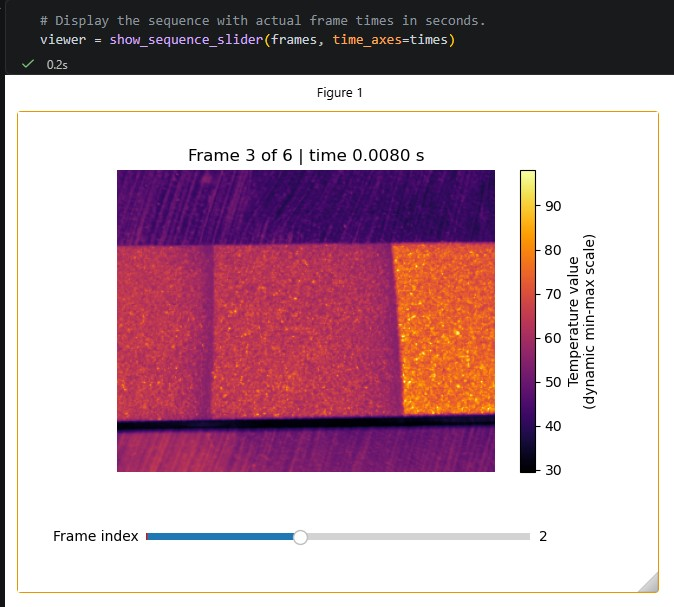

# LabIR File Python Loader

Load thermographic LRC recordings produced by LabIR into NumPy arrays and browse their frames with a slider. The arrays are then available for your own Python processing.

**Choose one complete guide. Both are equal alternatives using the same notebook:**

| Where you want to work | Guide |
| --- | --- |
| Visual Studio Code, already installed | [Complete VS Code guide](README_VSC.md) |
| Jupyter Notebook in a web browser | Follow this README below |

Git, GitHub Desktop, and Visual Studio Code are not required for the browser workflow, but a complete guide for Visual Studio Code is included. You only need to read the guide for your chosen workflow.

## 1. What you need

- Windows x64 and **64-bit Python**. Python 3.12 is the reference version.
- Anaconda Distribution for the browser workflow below. If already installed, keep your installation.
- Microsoft Visual C++ v14 **x64** runtime for the bundled `LRCRecording.dll`.
- Internet access for initial downloads and installation. Recordings can subsequently be read offline.

This DLL-based loader does not run on macOS, Linux, WSL, or Google Colab. For a pure-Python reader supporting a subset of LRC variants on other platforms, see [lrc-skill](https://github.com/labirthermal/lrc-skill) and the alternatives section below. It loads the entire recording into RAM. The example is about 1.9 MiB; larger recordings need more memory.

## 2. Download and extract the project

1. Open [the repository](https://github.com/msvantny/LabIR-File-Python-Loader). While private, sign in with the GitHub account given access. A `404` can mean your account does not have access.
2. Above the file list, choose **Code → Download ZIP**.
3. Find the ZIP in Windows File Explorer, right-click it, and choose **Extract All**. Do not work inside the ZIP.
4. Move the extracted folder somewhere you can write, such as Documents. You may rename it to `LabIR-File-Python-Loader`.
5. Open the folder. It must directly contain `Load_LRC.ipynb`, `loaders.py`, `visualization.py`, `requirements.txt`, `LRCRecording.dll`, and `LRC_Files`. If extraction created an extra outer folder, open the inner one containing these files.

Keep the files together; downloading only the notebook is insufficient. The **project folder** means the folder directly containing these files, for example:

```text
C:\Users\YourName\Documents\LabIR-File-Python-Loader
```

`YourName` is a placeholder. Use your real folder path, which may differ from this example.

## 3. Install prerequisites — first time only

### Anaconda

Skip this subsection if Anaconda is already installed.

1. Open the [official Anaconda download page](https://www.anaconda.com/download) and download **Anaconda Distribution for Windows x86_64 / 64-bit**.
2. Run the installer. Choose the current-user installation where offered and keep the default location and PATH settings. Adding Anaconda to the system PATH is not needed here.
3. Open the Windows Start menu, search for **Anaconda Prompt**, and launch it. This is a command window; you do not need Anaconda Navigator or PowerShell.

### Microsoft runtime

Open the [official Visual C++ Redistributable page](https://learn.microsoft.com/en-us/cpp/windows/latest-supported-vc-redist). Download the latest supported v14 **x64** package, run it, and choose **Install** or **Repair**. Follow any restart request. This is a runtime package, not the Visual Studio application.

## 4. Prepare Python — first time only

An **environment** is a separate Python installation with its own packages. We will create one named `labir-loader` to keep this project's packages separate from other work.

In **Anaconda Prompt**, enter each command separately, press Enter, and wait until it finishes. Do not copy Markdown fences or prompt text. When Conda asks whether to proceed, enter `y`. If asked to accept channel terms, review them before deciding whether to continue.

1. Create the environment:

   ```bat
   conda create -n labir-loader python=3.12 pip
   ```

2. Activate it:

   ```bat
   conda activate labir-loader
   ```

   The prompt should start with `(labir-loader)`.

3. In File Explorer, open the project folder, click its address bar, and copy its full path. Replace the example below with that path, keeping the quotes:

   ```bat
   cd /d "C:\Users\YourName\Documents\LabIR-File-Python-Loader"
   ```

4. Enter `dir` and press Enter. The list must include `requirements.txt` and `Load_LRC.ipynb`.
5. Install the dependencies and the browser notebook application:

   ```bat
   python -m pip install -r requirements.txt notebook
   ```

   Wait for completion without errors. `Requirement already satisfied` is normal.

6. Give this environment a recognizable notebook name:

   ```bat
   python -m ipykernel install --sys-prefix --name labir-loader --display-name "Python (LabIR Loader)"
   ```

### Optional installation cell in the notebook

The notebook keeps a commented installation command in **0. Install dependencies**:

```python
# %pip install -r requirements.txt
```

If you are unsure whether dependencies are available, remove `# `, run that cell, and wait for successful completion. Put `# ` back, restart the kernel, and run sections **1–3**. `%pip` uses the selected notebook environment and normally leaves packages satisfying the requirements installed. Missing or incompatible packages may be installed or updated; internet access may be needed. Keep the cell for a future computer or environment. **Run All** does not install anything while the line is commented.

This installs the project dependencies, not the browser notebook application. The `notebook` application must already be installed to open the notebook, as described above.

## 5. Open the notebook and run the example

1. In the same Anaconda Prompt, enter:

   ```bat
   jupyter notebook
   ```

2. Keep that command window open. A browser should open showing the project files. If it does not, copy the complete local URL printed in the command window, including its token, into your browser's address bar.
3. Click `Load_LRC.ipynb`. A **notebook** contains explanatory text and Python blocks called **code cells**.
4. Select **Python (LabIR Loader)** as the kernel. A **kernel** is the Python process running the code. If another name is shown, use **Kernel → Change Kernel** to choose the named environment.
5. The optional installation cell in section **0** is commented by default. Leave it commented if you completed setup above. Run the three processing code cells in sections **1–3**, in order, using **Shift+Enter**. An `[*]` indicator means a cell is running; wait until it finishes. Stop at an error and consult Troubleshooting below.
6. The loading cell in section **2** prints recording metadata. The viewer cell in section **3** shows a thermogram and **Frame index** slider. Move the slider to browse the frames.

The browser displays a Jupyter server on your own computer. This workflow does not upload recordings to GitHub or a cloud notebook service.

### Check that it worked

The included example should report:

```text
Resolution:          320 x 256 pixels (width x height)
Number of frames:    6
Array shape:         (256, 320, 6) (height, width, frames)
Frame interval:      4.000 ms
Sampling frequency:  250.000 Hz
Recorded time span:  0.020000 s
```

The value range is approximately **25.824 to 98.140**. The slider uses indices **0–5**, while the image title counts frames **1–6**. The color scale follows each frame's minimum and maximum: compare numeric color-bar values, not colors alone.



*Example result shown in VS Code. The browser workflow uses the same notebook viewer; the surrounding interface differs. Slider index 2 displays frame 3 of 6 at 0.0080 seconds.*

## 6. Load your own recording

**Path limitation:** use ASCII-only names for the LRC file and every folder in its full path (no accented letters or other non-ASCII characters). The current DLL call failed when the same working example was renamed to `měření.lrc`; spaces in a file name worked. If your Windows user name contains accented letters, put the recording in another writable folder with an ASCII-only full path. Adding `r` before a Python path string does not fix this encoding limitation.

Check the example first, then choose either method:

**Copy your file into `LRC_Files`**, without replacing the example. Change only this line in the loading cell in section **2** to your actual file name:

```python
file_path = "LRC_Files/my_recording.lrc"
```

**Keep the file elsewhere** and use its full Windows path instead. The `r` prefix allows backslashes:

```python
file_path = r"D:\Measurements\my_recording.lrc"
```

These are examples: substitute a file that exists on your computer. Re-run the loading cell, wait for completion, then re-run the viewer cell. An older viewer still refers to the previous array.

## 7. Use the arrays

The loading cell runs `frames, times = load_lrc(file_path)`:

| Variable | Meaning |
| --- | --- |
| `frames` | NumPy `float32` array, shape `(height, width, number_of_frames)` |
| `times` | NumPy `float64` array, one time in seconds from the recording beginning per frame |

Python indices start at zero. Add a code cell after loading to use the arrays:

```python
first_frame = frames[:, :, 0]        # First frame, all rows and columns.
pixel_values = frames[100, 150, :]   # Row 100, column 150, across all frames.
print(frames.shape)
print(times)
```

Choose pixel indices within the actual image dimensions. The LRC format defines stream-unit codes, but the DLL C wrapper used here does not expose that code. Values are not automatically degrees Celsius: depending on the camera and recording they may be temperature, intensity, or another quantity. This Python loader adds no unit conversion or radiometric correction; confirm the unit from explicit recording metadata and camera/export documentation. See **Library origin, units, and alternatives** below for the specification and API links. The complete temperature array alone requires `height × width × frames × 4` bytes, plus other working memory.

To load from your own Python script in this folder, use `from loaders import load_lrc`; the viewer is not required. Keep the DLL beside `loaders.py`. Load sequentially: concurrent or nested calls to the single-reader DLL interface are not supported. Compatibility with every LRC variant has not been established.

## 8. Start again next time

Do not repeat installation. Open Anaconda Prompt and run these commands with your actual project path:

```bat
conda activate labir-loader
cd /d "C:\Users\YourName\Documents\LabIR-File-Python-Loader"
jupyter notebook
```

Open `Load_LRC.ipynb`, select the same kernel, and run its code cells in order. After a kernel restart, saved pictures do not restore Python variables; load the data again.

Save edits with **Ctrl+S**. When finished, use **Kernel → Shut Down Kernel**, close the browser tab, return to Anaconda Prompt, and press **Ctrl+C**. If asked to shut down the server, enter `y`. Closing only the browser tab can leave it running.

Notebook saves may include plots and your input path. Clear outputs and restore the example path before sharing an edited notebook.

## 9. Troubleshooting

| Problem | Action |
| --- | --- |
| Repository shows `404` | Sign in with the GitHub account given access; ask the project owner to check permissions if needed. |
| `conda` is not recognized | Use **Anaconda Prompt** from Start. If missing, check your Anaconda installation. |
| Environment `labir-loader` already exists | Activate it instead of creating it again. |
| `requirements.txt` not found | Repeat `cd /d` and check `dir`. Use the folder containing that file. |
| `No module named loaders` or `visualization` | Keep both modules beside the notebook. Stop Jupyter and start it from the project folder. |
| Missing Python package or no `jupyter` command | Activate `labir-loader`, repeat step 4's installation command, and select **Python (LabIR Loader)** in the notebook. |
| `LRC file not found` | Check spelling, extension, and path. Try a full path using `r"..."`. |
| `Failed to open LRC file` although the file exists | Try a full path containing only ASCII characters, including every parent folder. Rename or copy the file if necessary. An `r` prefix alone does not fix DLL path encoding. |
| `LRC DLL not found` | Restore `LRCRecording.dll` beside `loaders.py` from the complete download. |
| `Failed to load DLL` or `WinError 126` | Check the DLL is present and install/repair the Microsoft Visual C++ v14 **x64** runtime. A dependency may be missing even if the DLL exists. |
| `WinError 193` or platform error | Use 64-bit Python locally on Windows x64. |
| Static image, no moving slider, or widget error | Check the kernel, repeat package installation, restart the kernel, and run sections **1–3** again. Keep `%matplotlib widget` in the **Enable interactive figures** cell. |
| `NameError` for `frames` or `times` | Run the loading cell successfully before the viewer, including after a restart. |
| Memory error on a large recording | Try the small example first; the whole recording must fit in available RAM. |
| Example works but your recording fails | Preserve the recording and complete error text. Contact the owner; the file may be damaged or use an unsupported variant. |

For diagnosis, run this in a new code cell and include its output with the complete error message:

```python
import struct
import sys
from pathlib import Path
print("Python:", sys.executable)
print("Version:", sys.version)
print("Bits:", struct.calcsize("P") * 8)
print("Working folder:", Path.cwd())
```

## Project files

| File | Purpose |
| --- | --- |
| `README.md` | Complete browser-based Jupyter guide |
| `README_VSC.md` | Complete, equal alternative for existing VS Code users |
| `LICENSE` | MIT license covering the supplied project files |
| `Load_LRC.ipynb` | Load a recording and show the slider |
| `loaders.py` | LRC loader returning NumPy arrays |
| `visualization.py` | Frame slider viewer |
| `LRCRecording.dll` | Public lrc-recording v2.1 Windows x64 library (MIT), supplied with the project |
| `requirements.txt` | Python packages; install `notebook` additionally for browser use |
| `docs/images/` | Screenshots illustrating kernel selection, loading output, and the viewer |
| `LRC_Files/sample_sequence_320x256_250Hz_006Fr.lrc` | Verified small example |

`.gitignore` excludes local environments, checkpoints, editor settings, generated figures, and additional LRC recordings. The named example is the exception. Ignore rules do not remove files already tracked in Git.

## Library origin, units, and alternatives

### Public library and attribution

The bundled Windows x64 `LRCRecording.dll` is the same binary as `Python/LRCRecording.dll` in the public [lrc-recording v2.1 release](https://github.com/labirthermal/lrc-recording/tree/v2.1), published on 12 November 2026 under MIT: [DOI 10.5281/zenodo.24165802](https://doi.org/10.5281/zenodo.24165802). Its source and API documentation are publicly available.

This loader adapts [Python/LRC_loading.py](https://github.com/labirthermal/lrc-recording/blob/v2.1/Python/LRC_loading.py), created in 2023 by Lukáš Mužika (credited in the original script as `LukasM`). Copyright (c) University of West Bohemia 2026 and the MIT terms are retained in [LICENSE](LICENSE).

The upstream C++ library supports reading and writing, with static and dynamic builds. This project provides only a small reading helper and viewer. Additional metadata, notes, seeking, and writing capabilities of the upstream library are not automatically exposed by `load_lrc()`.

The [C wrapper header](https://github.com/labirthermal/lrc-recording/blob/v2.1/LRCRecording/LRCRecordingWrapper.h) documents the API. This loader declares its ctypes argument and return types explicitly, calls `Close()` without an argument, and reads the `uint64_t` millisecond clock into a float64 seconds array. It acquires the frame buffer once and copies it before `NextFrame()` updates that shared buffer. The wrapper uses a single global reader, so loads must be sequential.

### Recorded values are not necessarily degrees Celsius

The public [LRC v2 format specification](https://github.com/labirthermal/lrc-recording/blob/v2.1/docs/LRC-FORMAT.md) defines a unit code in the stream header:

| Code | Meaning |
| --- | --- |
| 0 | None |
| 1 | Intensity |
| 2 | Degrees Celsius |
| 3 | Kelvin |
| 4 | Time |
| 5 | Radians |

The format can describe units, but the C wrapper used by this loader does **not expose the stream-unit code**. `frames` contains the values decoded by the DLL; the Python layer does not apply additional unit conversion or radiometric correction. Depending on the camera and recording, values may be temperature or another quantity. Do not infer degrees Celsius from the function name, value range, a screenshot, or another camera's behavior. Confirm the unit from the recording's explicit metadata and the camera/export documentation. Some calibration fields are specified in Kelvin; that does not imply that pixel values are in Kelvin.

### A pure-Python alternative for other platforms

[lrc-skill](https://github.com/labirthermal/lrc-skill) provides a NumPy-based reader without a DLL, plus optional analysis tools for AI agents or command-line use. It targets Windows, macOS, and Linux; its reader is also an option for a Python environment such as Colab, subject to package installation, data access, and format compatibility. That workflow is not tested by this project.

Its [0.1 release](https://github.com/labirthermal/lrc-skill/tree/0.1) is archived as [DOI 10.5281/zenodo.23596214](https://doi.org/10.5281/zenodo.23596214). It supports LRC v2 with one stream, supported uint16/float encodings, no external devices, and no dynamic header. Other variants raise an exception. This complements the upstream library; it does not guarantee support for every recording handled by the DLL.

Check the API before substituting it: `read_lrc()` returns `(T, H, W)` float32 frames, float64 times, and metadata; the compatibility function `load_lrc()` returns `(H, W, T)` frames and float32 times in release 0.1. Our DLL helper returns `(H, W, T)` frames and float64 times. Confirm units for your own recording with either reader; the alternative's examples in degrees Celsius do not establish the unit of every camera.

## License

Copyright (c) University of West Bohemia 2026.

The Python code, notebook, documentation, bundled `LRCRecording.dll`, example recording, and screenshots are provided under the [MIT License](LICENSE). You may use, modify, and redistribute them, including commercially, provided that you retain the copyright and license notice. They are provided without warranty; see the license for the full terms.

Third-party Python dependencies retain their own licenses.

## Funding

This work was supported by the Ministry of Education, Youth and Sports of the Czech Republic and co-funded by the European Union under the Johannes Amos Comenius Programme (OP JAK), project LABIR-PAV-2, No. CZ.02.01.01/00/23_021/0010932.

## Validation and references

### Tested configuration

The distribution notebook was executed in a fresh local Windows x64 environment on 24 November 2026 with Python 3.12.8, NumPy 2.5.5, Matplotlib 3.11.2, ipympl 0.10.0, ipykernel 7.4.0, and Notebook 7.6.5. Checks covered loading, all six slider frames and color ranges, array examples, and an external recording path. This was a kernel-based check, not a manual walkthrough of the browser or VS Code interface. The requirements specify minimum versions rather than a frozen environment.

### Further reading

- [Download a repository ZIP](https://docs.github.com/en/repositories/working-with-files/using-files/downloading-source-code-archives)
- [Install Conda on Windows](https://docs.conda.io/projects/conda/en/latest/user-guide/install/windows.html)
- [Install and launch Jupyter](https://jupyter.org/install)
- [Microsoft Visual C++ runtime](https://learn.microsoft.com/en-us/cpp/windows/latest-supported-vc-redist)
