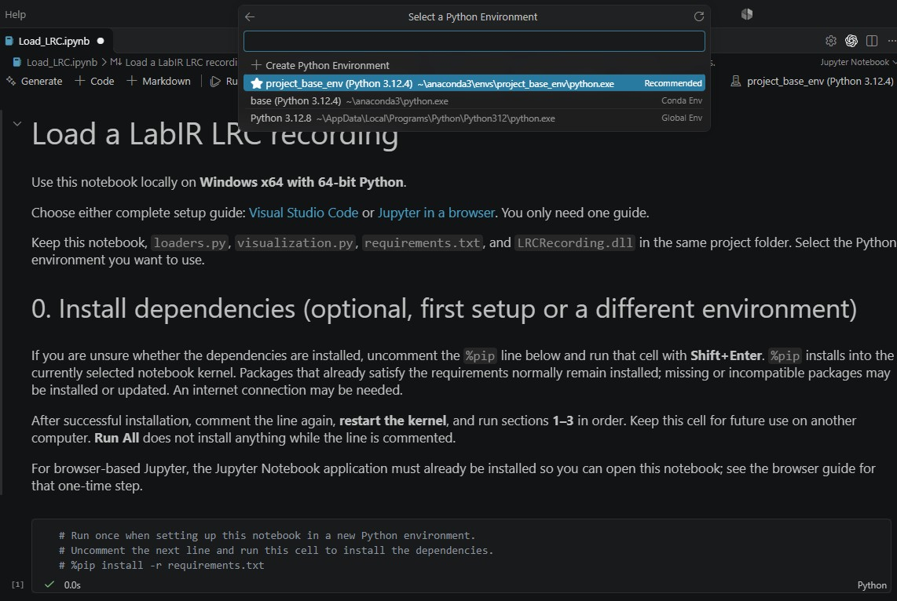
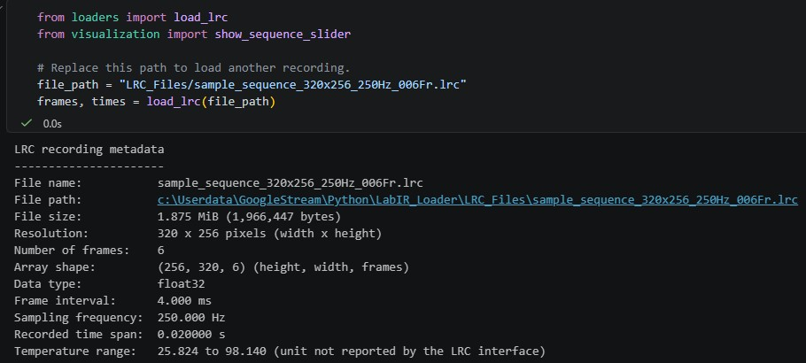
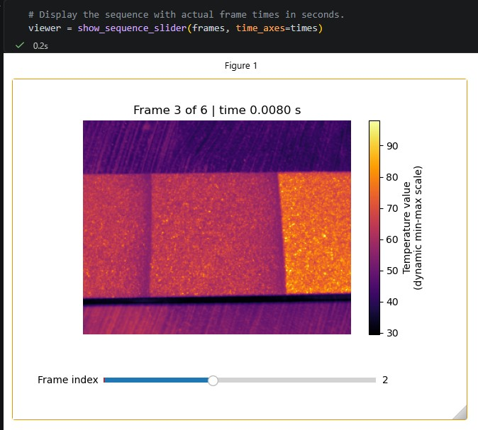

# LabIR File Python Loader — Visual Studio Code guide

**This is a complete, equal alternative to the browser-based Jupyter guide. You do not need to read the other README.** It assumes that VS Code is already installed and working. After extracting the project, you can complete the steps entirely in VS Code. Git, GitHub Desktop, Anaconda Navigator, PowerShell, and a separately launched Jupyter server are not required.

The project loads LabIR LRC recordings into NumPy arrays and provides a simple frame slider. The arrays are then available for your own processing.

## 1. Check the prerequisites

- Work **locally on Windows x64**, with **64-bit Python**. Python 3.12 is the reference version. WSL, Linux, macOS, Google Colab, and remote Linux kernels cannot use the Windows DLL.
- Have a Python installation available to VS Code, such as your existing Anaconda installation. VS Code itself does not include Python. If none is installed, obtain Windows x64 Python from [Python](https://www.python.org/downloads/windows/) or [Anaconda](https://www.anaconda.com/download), then restart VS Code. Python 3.12 matches the reference setup; other versions need verification.
- Install the Microsoft Visual C++ v14 **x64** runtime from the [official Microsoft page](https://learn.microsoft.com/en-us/cpp/windows/latest-supported-vc-redist). Download the x64 installer, run it, and select **Install** or **Repair**. This runtime is separate from the Visual Studio application.
- Internet access is needed for initial downloads and packages. Recordings are read locally afterwards.

## 2. Download and open the project folder

1. Open [the repository](https://github.com/msvantny/LabIR-File-Python-Loader). While private, sign in with the GitHub account given access. A `404` can mean the account is not authorized.
2. Click **Code → Download ZIP** above the file list.
3. In Windows File Explorer, right-click the ZIP and choose **Extract All**. Move the extracted folder somewhere writable, such as Documents. You may rename it to `LabIR-File-Python-Loader`.
4. Check that the folder directly contains `Load_LRC.ipynb`, `loaders.py`, `visualization.py`, `requirements.txt`, `LRCRecording.dll`, and `LRC_Files`. If extraction created an outer folder, open the inner one containing these files.
5. In VS Code, select **File → Open Folder** and open that project folder. If Workspace Trust is requested, review the source and trust it if you obtained it from the project owner and want to execute its code.
6. Check the files appear in Explorer. Open `README_VSC.md` and press **Ctrl+Shift+V** to preview this guide.

Keep the files together. Opening only the notebook from Downloads or inside the ZIP is insufficient. If you already cloned the project using your usual Git workflow, start at step 5 with the local folder.

## 3. Check the extensions

1. Open Extensions with **Ctrl+Shift+X**.
2. Install or enable **Python**, published by **Microsoft** (`ms-python.python`).
3. Install or enable **Jupyter**, published by **Microsoft** (`ms-toolsai.jupyter`).
4. Reload VS Code if requested.

These extensions provide Python and notebook support; they do not install the project's Python packages.

## 4. Select a Python environment

An **environment** is a Python installation with its packages. A notebook **kernel** runs the code using that environment. Use the same environment for installation and execution.

### Use an existing Python or Conda environment

1. Open `Load_LRC.ipynb` in Explorer. It should show explanatory text and code cells, not raw JSON.
2. Click **Select Kernel** at the top right, or click the current kernel name.
3. If needed, choose **Select Another Kernel → Python Environments** and select your local 64-bit Python environment, preferably Python 3.12. Use your own environment name; no particular Conda name is required.
4. If prompted to install `ipykernel`, accept and wait. You may need to select the kernel again.



*Example kernel selection. `project_base_env` is the author's environment name; choose your own suitable environment, not necessarily one with this name.*

### Or create a separate project environment

1. Press **Ctrl+Shift+P** to open the Command Palette.
2. Run **Python: Create Environment**, choose **Venv**, and select an installed 64-bit Python 3.12 interpreter. A local `.venv` folder is created. If asked to install dependencies, select `requirements.txt`.
3. Wait for creation to finish. Open `Load_LRC.ipynb` and choose the project's `.venv` through **Select Kernel → Python Environments**. Install `ipykernel` if prompted.

Choose either route, then continue below. Choosing **Python: Select Interpreter** for scripts does not replace checking the notebook's own kernel selector.

## 5. Install packages in that kernel — first time only

The notebook includes a permanent, optional installation cell. No terminal or temporary cell is needed:

1. Find **0. Install dependencies** near the top of `Load_LRC.ipynb`. Its code cell contains:

   ```python
   # %pip install -r requirements.txt
   ```

2. If this is a new environment, or you are unsure whether packages are installed, remove the leading `#` and space so that the line reads:

   ```python
   %pip install -r requirements.txt
   ```

3. Run that cell with **Shift+Enter** or its triangle Run button. `%pip` uses the selected notebook kernel. `Requirement already satisfied` is normal: packages satisfying the requirements normally remain installed. Missing or incompatible packages may be installed or updated, and internet access may be needed.
4. Wait for completion without errors. Then put `# ` back at the beginning of the line. Keep the cell for future use; do not delete it.
5. Use **Restart** in the notebook toolbar to restart the kernel, confirming if asked. Save with **Ctrl+S**, then run sections **1–3** in order.

Skip installation if this environment already has the dependencies. With the line commented, **Run All** leaves installation disabled. Uncomment it again when moving to another computer or environment, or if dependencies change. The separate `notebook` application is not needed for VS Code.

## 6. Run the example

1. Confirm the top-right kernel selector shows your chosen environment.
2. Run the code cell in **1. Enable interactive figures** with **Shift+Enter**. `%matplotlib widget` enables the interactive plot.
3. Run the code cell in **2. Load the thermography recording**, which loads the example through `LRCRecording.dll`. Wait for successful completion and the metadata printout.
4. Run the code cell in **3. Browse the temperature field**. A thermogram and **Frame index** slider should appear.
5. Move the slider to change frames. On later runs, you can use **Run All** instead of running cells individually.

The example should print:

```text
Resolution:          320 x 256 pixels (width x height)
Number of frames:    6
Array shape:         (256, 320, 6) (height, width, frames)
Frame interval:      4.000 ms
Sampling frequency:  250.000 Hz
Recorded time span:  0.020000 s
```



*Example loading output. The absolute file path is specific to the computer used for this screenshot; your path will be different.*

The value range is approximately **25.824 to 98.140**. Slider indices are **0–5**, while the title counts frames **1–6**. The color range changes with each frame's minimum and maximum, so compare numeric color-bar values rather than colors alone.



*The viewer at slider index 2: frame 3 of 6, at 0.0080 seconds. Move the slider to browse the recording.*

## 7. Load your own recording

**Path limitation:** use ASCII-only names for the LRC file and every folder in its full path (no accented letters or other non-ASCII characters). The current DLL call failed when the same working example was renamed to `měření.lrc`; spaces in a file name worked. If your Windows user name contains accented letters, put the recording in another writable folder with an ASCII-only full path. Adding `r` before a Python path string does not fix this encoding limitation.

Verify the included example first. Then choose either method:

**Copy your recording into `LRC_Files`** and change this line in the loading cell to your actual file name:

```python
file_path = "LRC_Files/my_recording.lrc"
```

**Keep your recording elsewhere** and use a full Windows path. The `r` prefix allows backslashes:

```python
file_path = r"D:\Measurements\my_recording.lrc"
```

Replace these examples with your real file name/path. Re-run the loading cell, wait for completion, then re-run the viewer cell. An existing viewer still refers to the previous array. The workflow reads locally and does not upload recordings to GitHub.

Additional LRC files are ignored by the supplied Git rules; the named example is the exception. Ignore rules do not untrack files already committed.

## 8. Use the arrays

The loading cell runs `frames, times = load_lrc(file_path)`:

| Variable | Contents |
| --- | --- |
| `frames` | NumPy `float32` array with shape `(height, width, number_of_frames)` |
| `times` | NumPy `float64` array with one time in seconds from the recording beginning per frame |

Add a code cell below the viewer, for example:

```python
first_frame = frames[:, :, 0]        # First frame: a 2D array.
pixel_values = frames[100, 150, :]   # Row 100, column 150, across all frames.
print(frames.shape)
print(times)
```

Indices start at zero and must fit the image dimensions. Values and calibration come from the DLL; the Python interface does not report their temperature unit and does not independently verify calibration. The entire recording is loaded into RAM. Its temperature array alone needs `height × width × frames × 4` bytes, plus working memory.

For a script in this folder, use `from loaders import load_lrc`; loading does not require the viewer. Keep `LRCRecording.dll` beside `loaders.py`. Load sequentially, since concurrent or nested DLL calls are not supported. The example does not establish support for every LRC variant.

## 9. Continue next time

1. Open the same folder in VS Code.
2. Open `Load_LRC.ipynb` and check its kernel.
3. Run the three processing code cells in sections **1–3**, in order, or use **Run All**.

No package installation is needed for each session. After a restart, saved pictures do not restore arrays in memory: run the code again. Save edits with **Ctrl+S**. Shut down the notebook kernel when finished, or close VS Code. Before sharing an edited notebook, clear outputs and restore the example path: saved notebooks may contain plots and your local input path.

## 10. Troubleshooting

| Problem | Action |
| --- | --- |
| Repository shows `404` | Check that you are signed in with an account given access. |
| Raw JSON or no notebook kernel selector | Enable Microsoft's Jupyter extension. Use **Reopen Editor With → Jupyter Notebook** from the editor tab menu if needed. |
| No Python environment | Check the local 64-bit Python/Anaconda installation and reload VS Code. The extension does not include Python. |
| `requirements.txt` missing | Open the complete folder with **File → Open Folder** and keep the notebook in its root. Check the working folder with the diagnostic cell below. |
| `No module named loaders` or `visualization` | Keep both modules beside the notebook. If you customized the notebook root directory setting, restore its default or set it to the project folder, then restart the kernel. |
| `ModuleNotFoundError` for a package | Check the notebook kernel, repeat step 5 in that kernel, and restart it. |
| Static image, no moving slider, or widget error | Repeat step 5, restart the kernel, and run sections **1–3**. Keep `%matplotlib widget` in the **Enable interactive figures** cell. |
| `NameError` for `frames` or `times` | Run the loading cell successfully before the viewer, especially after a restart. |
| `LRC file not found` | Check spelling and extension. Try a full path using `r"..."`. |
| `Failed to open LRC file` although the file exists | Try a full path containing only ASCII characters, including every parent folder. Rename or copy the file if necessary. An `r` prefix alone does not fix DLL path encoding. |
| `LRC DLL not found` | Restore `LRCRecording.dll` beside `loaders.py` from the complete download. |
| `Failed to load DLL` or `WinError 126` | Check the DLL is present and install/repair Microsoft's Visual C++ v14 **x64** runtime. Missing dependencies can cause this error even when the DLL exists. |
| `WinError 193` or platform error | Select a local Windows x64, 64-bit Python kernel, not a Linux/WSL or 32-bit kernel. |
| Memory error on a large file | Try the small example first. The complete recording must fit in RAM. |
| Example works but your recording fails | Preserve the recording and complete error text and contact the owner. It may be damaged or use an unsupported variant. |

For diagnosis, run this in a new code cell:

```python
import struct
import sys
from pathlib import Path
print("Python:", sys.executable)
print("Version:", sys.version)
print("Bits:", struct.calcsize("P") * 8)
print("Working folder:", Path.cwd())
```

Bitness should be **64**. The working folder should contain `loaders.py`, `requirements.txt`, and `LRC_Files`. Include this output, the complete error, and whether the example works when asking for help.

## License

Copyright (c) University of West Bohemia 2026.

The Python code, notebook, documentation, bundled `LRCRecording.dll`, example recording, and screenshots are provided under the [MIT License](LICENSE). You may use, modify, and redistribute them, including commercially, provided that you retain the copyright and license notice. They are provided without warranty; see the license for the full terms.

Third-party Python dependencies retain their own licenses.

## Validation and references

### Tested configuration

The notebook was executed in a fresh local Windows x64 environment on 24 November 2026 with Python 3.12.8, NumPy 2.5.5, Matplotlib 3.11.2, ipympl 0.10.0, and ipykernel 7.4.0. Loading, all six slider frames and color ranges, array examples, and an external path passed. These were kernel-based checks; the VS Code interface steps were checked against the official documentation, not manually exercised. Minimum package versions are specified in `requirements.txt`; other combinations need their own verification.

### Further reading

- [Jupyter notebooks in VS Code](https://code.visualstudio.com/docs/datascience/jupyter-notebooks)
- [Python environments in VS Code](https://code.visualstudio.com/docs/python/environments)
- [Download a repository ZIP](https://docs.github.com/en/repositories/working-with-files/using-files/downloading-source-code-archives)
- [Microsoft Visual C++ runtime](https://learn.microsoft.com/en-us/cpp/windows/latest-supported-vc-redist)
